<p align="center">
  
</p>

# Mimu

**Mimu remembers for you.**

Mimu is a voice notes app for people with too many ideas and not enough patience for note-taking. You tap the mic on your phone, say whatever's on your mind, and it's saved. Later, a model running on your own computer turns those rambling transcripts into tidy Markdown notes with a title, a category, and tags. You can search them, edit them, and export the whole library as plain Markdown whenever you want.

The speech recognition runs on your phone, and the organizing runs on your desktop. No paid AI API is involved anywhere.

## See it in action

Here's a quick demo video. Click the thumbnail to watch it on YouTube.

<p align="center">
  <a href="https://youtu.be/pFlZWNcPq-Y">
    
  </a>
</p>

### Desktop

<p align="center">
  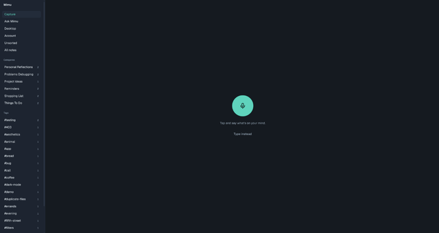
  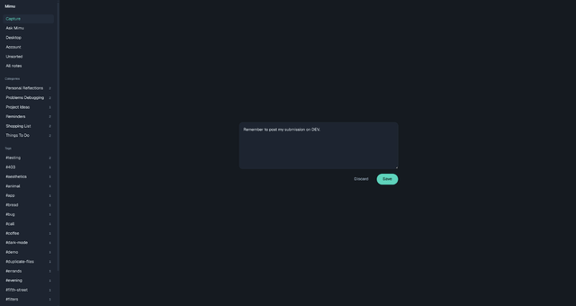
  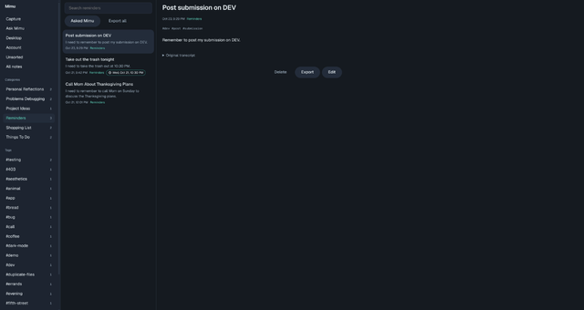
  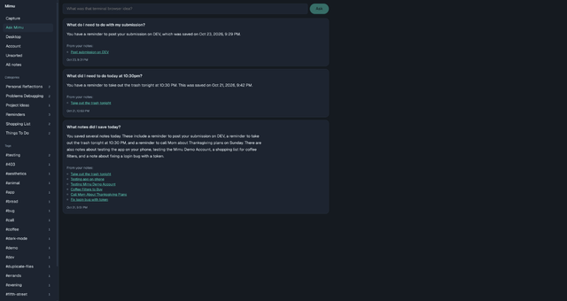
</p>

### Mobile

<p align="center">
  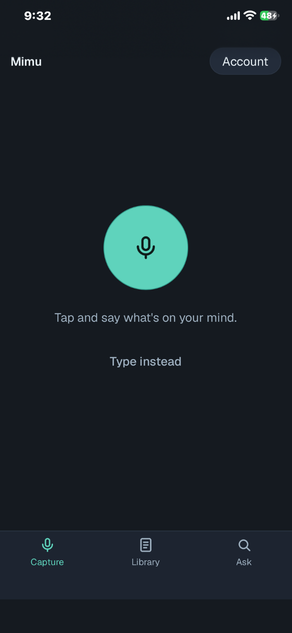
  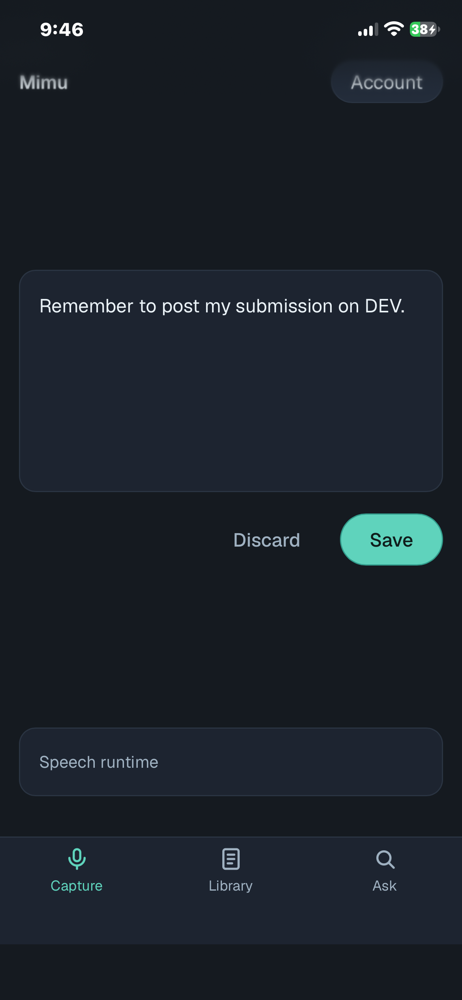
  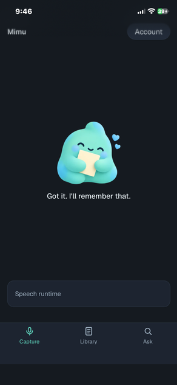
  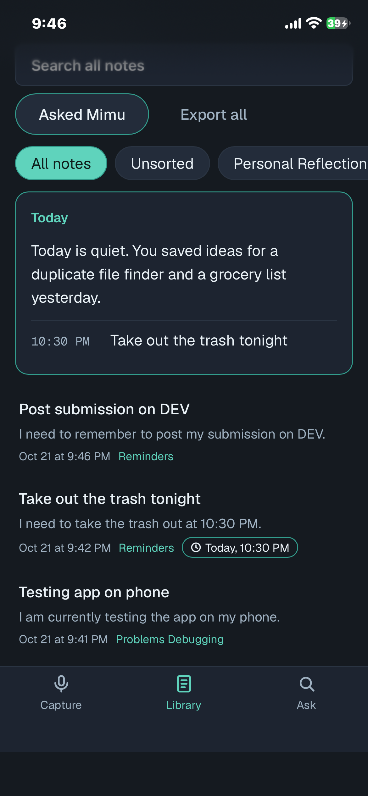
</p>
<p align="center">
  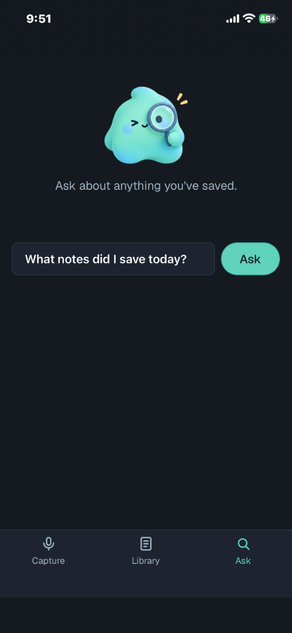
  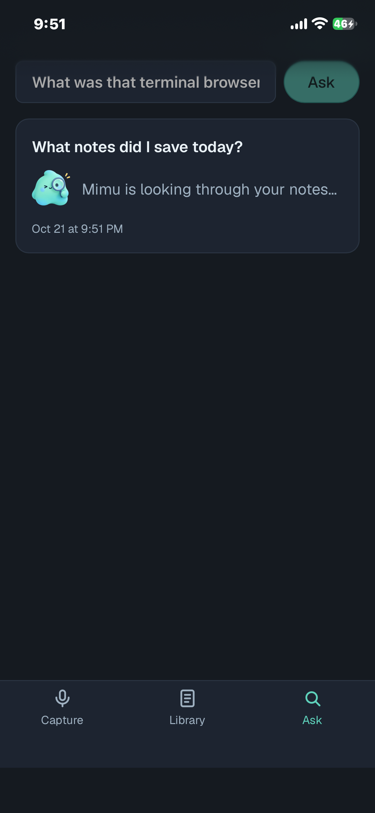
  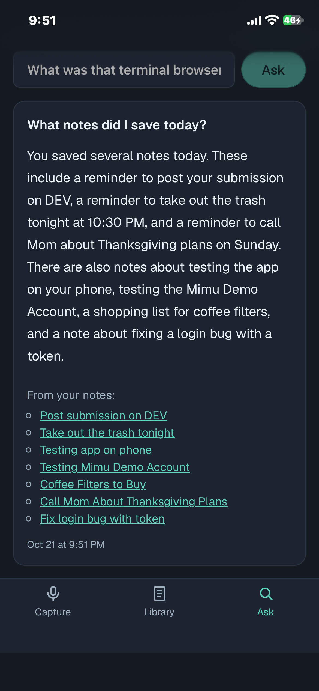
</p>

## Try it

There's a hosted demo at **[mimu.pinkpixel.dev](https://mimu.pinkpixel.dev)**, so you don't need a Turso or Cloudflare account to try Mimu.

1. Open the site and tap **Start a demo** (or **Continue with GitHub**). You get your own Mimu with a few sample notes already in it.
2. Install [Ollama](https://ollama.com/download) on a computer with a decent GPU.
3. Open **Desktop** in the sidebar, copy the command, and run it in a terminal on that computer. It installs the Mimu worker and downloads Gemma (a few GB, one time).
4. Open **Account** and tap **Show QR code**, then scan it with your phone's camera. Your phone is now signed in to the same Mimu.
5. Talk into your phone and watch the note get organized. Try one with a time in it, like "call the dentist tomorrow at 2".
6. Back on **Account**, tap **Turn on notifications** to get the morning digest and reminders. On iPhone, add Mimu to the Home Screen first and turn them on from there.

Demo accounts are deleted after 30 days without use, and you can delete yours any time from the Account page. In the demo, your note text is stored in a database on my Turso account. The audio still never leaves your phone, and Gemma still runs on your own computer. If you'd rather keep your notes completely to yourself, set up your own copy (below).

## How it works

```text
 Phone                               Cloudflare                     Your desktop
 ┌──────────────────────┐           ┌──────────────────┐           ┌──────────────────────┐
 │ Tap mic → Whisper    │  note     │ Worker           │  claim    │ Mimu worker (Node)   │
 │ (in the browser)     ├──────────►│  /     the app   │◄──────────┤  Gemma 4 via Ollama  │
 │ Review → Save        │           │  /api  the API   │  results  │  organizes notes     │
 └──────────────────────┘           └────────┬─────────┘──────────►└──────────────────────┘
                                             │
                                     Turso (libSQL + FTS5)
```

1. **Capture.** Whisper (`whisper-tiny.en`) runs right in the browser through Transformers.js, so your audio never leaves the phone. You can fix the transcript before saving, or skip the mic and type.
2. **Save.** The note goes into a queue on your device first, then uploads. If you're offline, it waits and syncs when you're back.
3. **Organize.** The Mimu worker on your desktop picks up new notes when it starts, every hour, and whenever you tap **Organize now**. Gemma 4 (`gemma4:e4b` by default) writes a title, a cleaned-up Markdown body, a summary, a category, and tags. Your original transcript is always kept.
4. **Browse.** Search across everything, filter by category, tag, or Unsorted, and edit anything by hand. Your edits are never overwritten by the worker.
5. **Remember.** If a note says when something's happening ("thursday at 2", "the first"), Gemma works out the date and time using when you said it and your phone's timezone. Every morning at 8, the worker writes a short digest of what's due today and what you saved yesterday. With notifications on, the digest lands on your phone, plus a reminder 30 minutes before anything with a time.
6. **Ask.** Ask things like "who do I need to call?" or "what did I save yesterday?". The desktop worker searches your notes and answers from them only, with links to the notes it used.
7. **Export.** Download one note as `.md`, or the whole library as a ZIP of Markdown files grouped into category folders.

## Features

- One-tap voice capture with on-device transcription, plus a "Type instead" option
- Offline capture queue with a small sync badge when something's waiting
- Automatic titles, Markdown cleanup, categories, and tags from a local model
- Categories stay tidy: "Developer Tool" gets filed into an existing "Developer Tools" instead of creating a near-duplicate
- **"Mimu wasn't sure about"**: phrases that look misheard (like "the token cinnamons after an hour") get flagged next to the note instead of being quietly guessed at
- Full-text search with prefix matching and stemming
- **Due dates from what you said**: "call the dentist thursday at 2" becomes a note due Thursday at 2:00 PM, worked out by Gemma from when you said it and your timezone
- **Morning digest**: at 8 every morning, Gemma writes a few sentences about today and yesterday. It shows up in a **Today** card at the top of the library and as a desktop notification.
- **Phone notifications**: the digest, plus a reminder 30 minutes before anything with a time, sent even when your computer is off
- **Ask Mimu**: plain-language questions about your notes, answered by your local model from your notes only. If nothing matches, it says so instead of making something up.
- Manual editing, delete with confirmation, and the original transcript one tap away
- Markdown export with YAML frontmatter, stable note IDs, and a `manifest.json`, which also works in Obsidian
- Add to Home Screen on iOS for a full-screen app with the Mimu icon
- Works on phones and desktops: Capture, Library, and Ask tabs on the phone, sidebar plus list and detail panes on a bigger screen
- Pair your phone by scanning a QR code on the Account page (hosted demo)

## What you need

- **Node.js 22+** and **pnpm 11** to set up the server (the desktop only needs Node.js 22+ and npm)
- **[Ollama](https://ollama.com)** on the computer that will organize your notes. A GPU helps a lot. I use an RTX 4090 laptop GPU, where a note takes about 4 seconds.
- A free **[Cloudflare](https://cloudflare.com)** account (the app and API run on one Worker)
- A free **[Turso](https://turso.tech)** account (the database)

Your own copy of Mimu is single-user, protected by one access key. (The hosted demo works differently, with a separate account and database for each person. See [Running a hosted demo](#running-a-hosted-demo) if you want to run one yourself.)

## Setup

Setup has two halves. The server half runs once from the repo and puts the app and API on Cloudflare. The desktop half is one command you paste into a terminal on the computer that runs Gemma.

### 1. Install

```bash
git clone https://github.com/pinkpixel-dev/mimu.git
cd mimu
pnpm install
```

### 2. Run the quickstart

Create a database in the [Turso dashboard](https://app.turso.tech) first, and keep its URL (it starts with `libsql://`) and an auth token handy. Then run:

```bash
pnpm quickstart
```

It asks for the Turso URL and token, generates an access key, sets up the database tables, builds the app, and deploys it to Cloudflare. If you're not logged in to Wrangler yet, it opens your browser for that. At the end, it prints your Mimu URL, your access key, and the desktop command.

Everything it sets up is saved in `apps/api/.dev.vars`, so running it again reuses the same database and key and just redeploys. That's also how you update your deploy after pulling new changes.

It's `pnpm quickstart` and not `pnpm setup`, because `pnpm setup` is one of pnpm's own commands.

### 3. Connect your desktop

Install [Ollama](https://ollama.com/download) on the computer that will organize your notes. Then open Mimu, go to **Desktop** in the sidebar, tap **Copy**, and paste the command into a terminal on that computer. It looks like this:

```bash
npm install -g @pinkpixel/mimu-worker && mimu-worker setup --url https://mimu-api.<you>.workers.dev/api --key your-access-key
```

That installs the Mimu worker, checks your key, downloads `gemma4:e4b` if you don't have it yet (a few GB, one time), and sets the worker up to start in the background whenever you log in. On Linux that's a systemd user service, and on macOS it's a launchd agent. The Desktop page switches to **Connected** within a few seconds.

To watch it work on Linux:

```bash
journalctl --user -u mimu-worker -f
```

On macOS, the log is at `~/Library/Logs/mimu-worker.log`.

I've tested the background service on Linux. The macOS version is written but I haven't been able to try it on a Mac yet. On Windows (or anywhere you'd rather not have a service), run `mimu-worker` in a terminal and leave it open.

The worker saves its settings in `~/.config/mimu/worker.json`. Other `mimu-worker` commands:

```bash
mimu-worker                    # run in this terminal instead of the background
mimu-worker install-service    # turn the background service back on
mimu-worker uninstall-service  # stop starting at login (settings stay saved)
mimu-worker --help
```

### Manual setup

If you'd rather do each step yourself, this is everything the quickstart does.

Create `apps/api/.dev.vars`. The file name starts with a dot, and that matters: the dotted name is the one that's gitignored. `apps/api/.dev.vars.example` lists every setting with a short note on each, so you can copy that and fill it in. For a normal install you only need these three:

```bash
TURSO_DATABASE_URL=libsql://your-database.turso.io
TURSO_AUTH_TOKEN=your-turso-token
MIMU_ACCESS_KEY=pick-a-long-random-string
```

You can generate an access key with:

```bash
openssl rand -hex 32
```

Set up the database tables:

```bash
pnpm migrate
```

Log in to Wrangler, then build and deploy the app and API together, uploading the same three values as Worker secrets:

```bash
cd apps/api
pnpm exec wrangler login
pnpm --filter @mimu/web build
pnpm exec wrangler deploy --secrets-file .dev.vars
cd ../..
```

Wrangler prints your URL when it's done, something like `https://mimu-api.<you>.workers.dev`. You can also attach a custom domain in the Cloudflare dashboard.

For the desktop worker, you can also run it straight from the repo instead of installing the npm package. Pull the model and copy the example config:

```bash
ollama pull gemma4:e4b
cp apps/worker/.env.example apps/worker/.env
```

```bash
MIMU_API_URL=https://mimu-api.<you>.workers.dev/api
MIMU_ACCESS_KEY=the-same-key-as-before
```

Make sure the URL ends in `/api`. Then start the worker and leave it running:

```bash
pnpm worker
```

The `.env` file also has optional settings for the Ollama host, the model, how often it runs (`MIMU_INTERVAL_MINUTES`, default 60), how often it checks for **Organize now** (`MIMU_POLL_SECONDS`, default 10), and how often it checks for new questions (`MIMU_ASK_POLL_SECONDS`, default 3). These environment variables work with the npm version too, and they win over whatever `mimu-worker setup` saved.

## Using Mimu

1. Open your Worker URL on your phone. The API URL is filled in for you, so paste your access key and tap **Connect**.
2. On iPhone, tap **Share → Add to Home Screen** to get the Mimu icon and full-screen mode.
3. Tap the mic, talk, and tap again. Fix anything that came out wrong, then **Save**.
4. Your note shows up in **Library → Unsorted** as "Waiting for Mimu" until the desktop worker organizes it. Tap **Organize now** if you don't want to wait for the hourly run.
5. Open a note to read it, check the original transcript, **Edit** it, or **Export** it. **Export all** in the library downloads everything.
6. Open **Ask** and ask about anything you've saved. Answers usually take a few seconds and link to the notes they came from. Your desktop worker needs to be running for this.
7. Open **Desktop** any time to check whether your desktop worker is connected, or to copy the setup command again.
8. **Account** (in the sidebar, or the button at the top of the capture screen on phones) turns notifications on or off for each device and can send a test. On the hosted demo, it also has the QR code for your phone, GitHub linking, sign out, and delete.
9. The **Today** card at the top of the library shows this morning's digest and anything due today.

The first time you open the capture screen, it downloads the Whisper model (about 41 MB). After that, it's cached.

## Privacy

- **Audio stays on your phone.** It's transcribed in the browser and then thrown away. Only the text gets uploaded.
- **Your notes live in your own Turso database**, behind your own Worker and access key.
- **The organizing runs on your own machine** through Ollama. Note text never goes to an AI provider.
- The browser downloads the Whisper model files from Hugging Face and the ONNX Runtime files from jsDelivr. Neither one sees your audio or notes.
- **Phone notifications** travel through your browser's push service (Apple's, Google's, or Mozilla's). The contents are end-to-end encrypted with your device's key, so the push service can't read them.
- **On the hosted demo**, the first two points still hold, but your note text lives in a database on the demo's Turso account instead of yours. Each demo account gets its own database, and it's deleted after 30 days without use or when you delete your account.

## Notifications on your own Mimu

The morning digest shows up in the app and as a desktop notification with no setup. For phone notifications, the Worker needs a pair of VAPID keys (that's how push services know notifications really come from your Mimu):

```bash
pnpm --filter @mimu/api vapid
pnpm quickstart
```

The first command generates the keys into `apps/api/.dev.vars` and asks for a contact email (push services only use it if something goes wrong). The second redeploys with them. Then open **Account** on your phone and tap **Turn on notifications**. Keep the same keys from then on, since new keys would mean turning notifications on again on every device.

The digest time is the desktop's clock. Set `MIMU_DIGEST_HOUR` (0 to 23) for the worker if 8 doesn't suit you.

After pulling an update, run `pnpm migrate` before deploying. On a hosted demo, it also brings the accounts database and every demo account's database up to date.

## Running a hosted demo

This is how mimu.pinkpixel.dev runs. You don't need it for your own notes, but it's there if you want a public instance where anyone can sign up.

Each sign-up gets its own Turso database, created through the Turso Platform API and filled with sample notes. A separate `mimu-accounts` database keeps track of who owns which database. Your own access key keeps opening your own notes like before.

1. Mint a Turso Platform API token and add it to `apps/api/.dev.vars` as `TURSO_PLATFORM_TOKEN`:

   ```bash
   turso auth api-tokens mint mimu-demo
   ```

2. Run the hosted setup. It creates the `mimu-accounts` database, mints a group token that opens every database in the group, and saves the rest of the settings to `.dev.vars`:

   ```bash
   pnpm --filter @mimu/api hosted-setup
   ```

3. For GitHub sign-in, create a GitHub OAuth app with the callback URL `https://<your-domain>/api/auth/github/callback`, then add `GITHUB_CLIENT_ID` and `GITHUB_CLIENT_SECRET` to `.dev.vars`. You can skip this step, and people will just use **Start a demo**.
4. Deploy with `pnpm quickstart`, which uploads everything in `.dev.vars` as Worker secrets.

Sign-ups stop at `MIMU_DEMO_MAX_ACCOUNTS` (50 by default), and a daily Cloudflare cron deletes accounts nobody has used in 30 days. Turso's free plan allows 100 databases, so 50 leaves room for your own.

If `turso auth login` fails with a SQL syntax error, the `turso` on your PATH is probably the npm package `turso` (the new database engine's shell), not the Turso Cloud CLI. The Cloud CLI installs to `~/.turso/turso`.

## Export format

**Export all** gives you a ZIP like this:

```text
mimu-export/
├── Project-Ideas/
│   └── duplicate-file-analyzer.md
├── Tasks/
│   └── call-mom-about-thanksgiving-plans.md
├── Unsorted/
│   └── pick-up-more-coffee-filters.md
└── manifest.json
```

Each file has YAML frontmatter (`id`, `title`, `created`, `updated`, `category`, `tags`, `status`, plus `due`, `uncertain`, and `edited` when they apply), then the organized note, then the original transcript as a quote. Notes Mimu hasn't organized yet go in `Unsorted/` as the raw capture. Exports are built straight from your saved notes, so they don't need the desktop or the model.

## Troubleshooting

**The worker says "Expected JSON… Does MIMU_API_URL end in /api?"**
Add `/api` to the end of `MIMU_API_URL`. Every other path on the Worker serves the web app, so the worker gets HTML back.

**The iPhone page reloads right after "Getting ready" hits 100%.**
That's iOS killing the tab, which happened with WebGPU on my iPhone. Mimu uses WASM by default for this reason. If you've added `?runtime=webgpu` to the URL, remove it.

**Notes stay "Waiting for Mimu".**
Open **Desktop** in the app. If it doesn't say **Connected**, check that the worker is running (`systemctl --user status mimu-worker` on Linux, or `pnpm worker` if you run it from the repo), that Ollama is running, and that the model is pulled (`ollama list`). The worker logs every note it organizes.

**Ask Mimu says "Still waiting. Is the Mimu worker running on your desktop?"**
Questions sit in a queue until the worker picks them up. Start the worker (see above), and the waiting question gets answered within a few seconds.

**The background service stopped working after I changed Node versions.**
The service remembers the exact Node.js path it was installed with. If that version goes away (say you removed it with nvm), run `mimu-worker install-service` again from the Node version you're using now.

**`mimu-worker setup` says "Mimu rejected that access key".**
Copy the command again from the **Desktop** page. If you changed the key, the old command has the old one in it.

**"Key rejected · Reconnect" shows up in the app.**
The access key changed. Tap it and enter the new one. Anything you saved is still queued on the device.

## Development

Run the API locally against a throwaway database file, so testing never touches your real notes:

```bash
pnpm --filter @mimu/api dev:local
```

That serves the API at `http://127.0.0.1:8788` using `apps/api/local.db` and the access key from `.dev.vars`. In another terminal, start the web app:

```bash
pnpm dev:web
```

Open `http://localhost:5173` and connect to `http://127.0.0.1:8788`. To organize local notes, point the worker at it:

```bash
MIMU_API_URL=http://127.0.0.1:8788 pnpm worker
```

To work on the hosted demo locally, start the API in hosted mode. Accounts and their databases go in `apps/api/local-demo/`, and nothing touches Turso Cloud:

```bash
MIMU_LOCAL_HOSTED=1 pnpm --filter @mimu/api dev:local
VITE_API_URL=http://127.0.0.1:8788 pnpm dev:web
```

Tests and type checks:

```bash
pnpm test
pnpm typecheck
```

Two small scripts compare models and prompts on sample transcripts, and a third rebuilds the hosted demo's sample notes with the real organize pipeline:

```bash
pnpm --filter @pinkpixel/mimu-worker spike:gemma gemma4:e4b gemma4:12b
pnpm --filter @pinkpixel/mimu-worker spike:uncertain gemma4:e4b
pnpm --filter @pinkpixel/mimu-worker seed:build gemma4:e4b
```

### Project layout

```text
apps/
  web/      React + Vite app: capture, library, export, connect screen
  api/      Hono API on Cloudflare Workers; also serves the built web app (src/hosted/ is the hosted demo)
  worker/   Node worker that organizes notes with Gemma through Ollama (published as @pinkpixel/mimu-worker)
packages/
  shared/   Schemas, slug helpers, and the Markdown export format
assets/     Mascot and app icon
```

## Limitations

- Your own copy is single-user, protected by one access key. Accounts only exist on a hosted demo.
- English only for now (`whisper-tiny.en`).
- Notes only get organized, questions only get answered, and the morning digest only gets written while your desktop worker is running. Reminders for notes that already have a time don't need it.
- Push notifications on iPhone only work after adding Mimu to the Home Screen. The Home Screen app keeps its own sign-in, separate from Safari, so you sign in once more there (GitHub or your key).
- Due dates come from a small model reading casual speech. In testing it got every phrase right, but mumbled or ambiguous dates can still come out wrong, so check the badge on anything important.
- Ask Mimu finds notes by keyword (with some help from Gemma picking search words), not by meaning, so a question worded very differently from the note can miss it.
- The app itself needs a connection to load. Captures still queue offline once it's open.

## License

[Apache 2.0](LICENSE)

---

Made with 💖 by [Pink Pixel](https://pinkpixel.dev)
